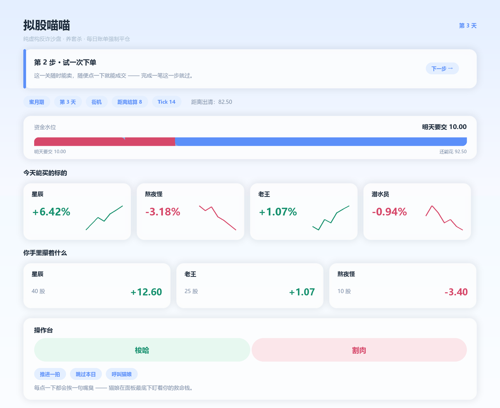

# 拟股喵喵（纯虚构 · 反诈沙盘）

> **一句话**：一个跑在 N.E.K.O. 插件系统里的纯虚构反诈沙盘 ——
> 早期让你小赢，在你最上头的那一秒精准收割。零成本体验被收割的全过程。



> *面板示意（按面板自身的设计变量离线渲染，**非真机截图**）：顶部是 P18.0 的动态教程教练条，
> 往下依次是状态徽标、资金水位条、行情方块卡网格、持仓方块卡与胶囊操作台。*

## ⚠️ 免责声明（先看这条）

《拟股喵喵》是一个**纯虚构、纯娱乐**的反诈教学游戏。

- 所有标的 ID 形如 `FAKE-xxx`，**不映射**任何真实股票代码或外汇对
- 价格、费率、代币均为虚构数值，**无现金价值**
- 代码中**不存在**充值、提现、兑换、入金、出金一类功能，连变量名与占位符都没有
- **不提供**充值、提现、兑换、真实行情对接、投资建议或任何金融服务
- 灵感来自早期同类虚构作品，但不使用任何已有作品的版权内容、角色名与视觉素材
- 默认仅限本地 / 局域网运行，请勿部署为公开金融服务；本项目不承诺长期维护

> 你连这个游戏都玩不过，就别去真实市场送钱了。

## 玩法特色

| | 特色 | 你会经历什么 |
| :-- | :-- | :-- |
| 🎯 | **养套杀** | 引擎里有一条真实的「上头指数」曲线：先小赢，等你追高、加仓、补仓，heat 越过峰值再精准收割。局中隐藏，结算才揭晓 |
| 🧾 | **每日账单强制平仓** | 每天要交生活费；交不上会被清出去，连着断供就彻底出局。资金水位条上那条红线就是你的命 |
| 🐈 | **外置猫娘全程解说** | 猫娘在聊天框里实时嘴臭。P18.0 起，**教程台词 100% 由她生成** —— 插件只给事实，一个字台词都不写死 |
| 🎓 | **分档次动态教程** | 街机 / 入门 / 命运挑战 / 无尽各教各的：目标被圈出来、步骤跟着玩家的处境走、课讲完给一段风险提示 |
| 🎭 | **名字彩蛋引擎** | 开局先报个名（默认「无名韭菜」，提示语：*别用真名，丢人*）。报「巴菲特」直接地狱开局、「星辰」每天白捡点、「老大」开局就签魔爪契约 —— 四类名号，**效果全在插件层**，引擎一行不改 |
| 🍃 | **渐进式面板** | 街机是**纯爽局**（水位条 / 集中度警告 / 连击 / 多标的台账全藏起来）、入门开始**教生存**（恢复水位线）、后面三档**火力全开** —— 信息密度跟着档位走，不在新手村吓跑人 |
| 📊 | **去金融化** | 总资产叫「零花钱 / 家底 / 救命钱」，买入叫「梭哈」，卖出叫「割肉」，强制平仓叫「底裤被扒」 |
| 🌈 | **清丽轻科技风** | 浅蓝到纯白的纵向渐变 + 毛玻璃卡片 + 薄荷绿珊瑚粉，行情与持仓都是方块卡 |
| 🎲 | **社区名册** | 6 位群友直接出现在行情方块卡里，各带小头像、各有脾气；猫娘弹幕框固定在面板底部 |
| 🎬 | **导演台（特制版）** | 让指定标的暴跌、强制放高利贷、赛博弹窗轰炸 50 个小丑 —— **引擎一行不改** |

### 五档速查

| 档位 | 一句话 | 特点 |
| :-- | :-- | :-- |
| 街机 | 新手村 | 没有生活费，纯练手；新手期放水，闭着眼买也能赚 |
| 入门 | 断供前夕 | **开始要交生活费**了（每天 10），初始资金加厚 |
| 进阶 | 收割场 | 生活费翻倍 + 杠杆，水位线一咬到底 |
| 地狱 | 命线最紧 | 十倍杠杆 + 最贵的账单 |
| 无尽 | 深渊 | 不会自动结束：工资、高利贷、敲钟日轮着来 |

### 这个项目在意的三件事

1. **引擎层一个字节都不改** —— `engine/` 与 `modes/` 从 P1 到 P20 零改动，
   500 局模拟基线逐字节全等（4352 B / SHA256 `174ADEA8…60AEF`）。
2. **不硬编码台词** —— 猫娘说的每一句都由 AI 生成，插件只提供**事实**与**内容约束**。
3. **不引入危险 CSS** —— 面板只用宿主原生组件 + `outline` / `box-shadow` 描边，
   没有 `position: absolute`、没有 `filter`、没有 `@keyframes`。

## 这是什么

一个跑在 N.E.K.O. 插件系统里的纯虚构反诈沙盘。核心机制是「养套杀」：
早期让你小赢，在你最上头的瞬间精准收割。

- 所有标的 ID 形如 `FAKE-xxx`，**不映射**任何真实股票代码或外汇对
- 价格、费率、代币均为虚构数值，无现金价值
- 代码中**不存在**充值、提现、兑换、入金、出金一类功能，连变量名与占位符都没有
- 灵感来自早期同类虚构作品，但不使用任何已有作品的版权内容、角色名与视觉素材

## 当前状态

**P27.2 完成**。游戏可玩：四个经典档 + 一个无限档，插件管理页里有完整的 Hosted TSX 面板。
P7.2 做了一次**彻底的「游戏化减法 + 抽象化加法」**：面板不再是专业炒股软件；
P7.3 修掉了 0.8.2 真机暴露的**弹窗死锁事故**；
P7.4 修掉了 0.8.3 真机暴露的**「没法开局」入口事故**；
P8.0 把它**正式化**成《拟股喵喵》，并把 UI 整个翻成**清丽轻科技风**；
P18.0 把干巴巴的玩法说明换成了**跟着玩家走的动态教程**；
P19.0 补上了入门档的课，并给直播留了两个隐藏开关；
P20.0 让玩家**有了名字**，并把名字变成了一整套**彩蛋引擎**；
P21.0 做了一次**减法**：面板的信息密度跟着档位走，全屏下 K 线与数字会**自己长大**，
跳过教程的人第一次动手时旁边会飘出一行**幽灵提示**把他领到猫娘那儿；
P23.x ~ P26.1 一路为**直播**补齐了极简肾上腺素 UI、Yui 托管、兜底与护栏；
P27.0 又补上**做空 / 专属彩蛋 / 对手曲线 / 报纸与团队**四件套，当晚出 `0.11.3-stable`；
P27.1 是直播前夜的**紧急补丁**：根治 Yui 的「虚空交易」幻觉，并把面板整个压成
**一屏卡片化**（顶部概览卡 + 深色 K 线画布 + 底部三键操作台），出 `0.11.4-stable`；
P27.2 是直播前的**最后一轮压测**：30 局模拟直播全绿、Yui **防追单**双保险、
深色画布的 WebView 兼容探针全绿，出 `0.11.5-live-final`；
P28.0 是**终极冲刺**：第一关（街机档）**极度降智大砍** —— 屏幕上只剩超大 K 线、
【掏钱买】【割肉卖】两个大按钮和当前的【现钱】，**永不上头暴跌**、买亏了系统暗中
补钱（永远是赚的）；直播模式**彻底分化**成【Yui 全权代打（纯看戏）】与
【人机协同双打】；假报纸被识破时猫娘**替玩家发火**，出 `0.12.0-live-ultimate`。

- **正式化**（0.9.0）：内部 ID 改成 `mock_stock_meow`，中文名《拟股喵喵》，
  界面上不再有早期版本沿用下来的旧字眼。
- **清丽风**（0.9.0）：从暗色调赛博朋克整个翻面成浅色 —— 极浅灰蓝→纯白的纵向渐变、
  半透明白色卡片（`rgba(255,255,255,0.72)` + 16px 圆角 + 极淡阴影）、
  涨是薄荷绿 `#5AC8A8`、跌是珊瑚粉 `#FF6B81`。
  实现方式是**在面板根节点上重新定义宿主的 CSS 变量** —— 宿主所有组件
  （卡片 / 按钮 / 徽标 / 文本）一次性跟着变浅，不用逐个组件覆写。
- **方块卡片网格**（0.9.0）：行情列表从表格换成**方块卡片**（宿主 `Columns` 的
  fluid 模式：面板宽就 4 列、窄就 2 列），每格 = 股票名（+ 群友小头像）+
  微型折线 + **巨大**涨跌百分比。持仓也换成了同一套方块卡。
- **胶囊操作台**（0.9.0）：「一键梭哈 / 一键割肉」是两个**并排的胶囊大按钮**
  （各占一半宽，带一点点薄荷绿 / 珊瑚粉微光），辅助按钮（跳过本日 / 领工资 /
  借高利贷）**缩小**放在下面。
- **家道三档**（0.9.0）：右上角的资金卡片随家道变 —— 富二代【零花钱】、
  断供【家底】、濒临破产【救命钱】；界面上不再有「资金 / 总资产」这种后台味儿的词。
- **轻量素材**（0.9.0）：`ui/assets/` 里有 6 个群友头像和 2 张梗图，
  面板用**内联 data URI** 渲染（宿主不服务插件目录，相对路径必然 404）。
- **极简**（0.7.2）：行情只剩「名称 + 走势小折线 + 超大红绿涨跌」，
  持仓只剩「名称 + 当前市值 + 大号盈亏」，K 线搬到**面板最上方**占满全宽当主视觉。
- **去金融化**：总资产按档位叫「零花钱 / 家底 / 救命钱」，买入叫「梭哈」，
  卖出叫「割肉」，强制平仓叫「底裤被扒」；富二代圆润字体、断供细字体、
  濒临破产档的数字偶尔闪红。
- **抽象彩蛋**：社区名册 6 人，**群友直接出现在行情方块卡里**
  （星辰永远是最稳的那只，Wehos 永远是最野的那只，还各带一个小头像），
  猫娘弹幕框**固定在面板底部**，玩家每点一下必有一句刻薄嘲讽。
- **导演台**新增「赛博弹窗轰炸」：50 个 🤡、关不掉、封锁操作 5 秒。
- **防死锁**（0.8.3）：网贷弹窗点了**立刻**关窗、永远带一个「我不借了，把我清出去吧」
  的逃生按钮、30 秒没人操作就自动结算；轰炸有**客户端硬截止**；标题栏多一个
  极小的「退出对局」紧急逃生按钮。
- **入口打通**（0.8.4）：空闲态有**两个真的能点**的开局按钮（经典 / 无尽），局中的
  操作区在空闲态**整体隐藏**；聊天框里说「加入一局」能**真的**触发插件（新增
  `@llm_tool`）；面板**自己每 3 秒**拉一次上下文，宿主不轮询也不会看到陈旧面板。
- **动态教程**（0.10.1）：后端状态机（开场 → 逐步 → 结课小结），街机 4 步、
  命运挑战 3 步、无尽 6 步（网贷课是**延迟节点** —— 等玩家真交不起饭钱才开课）；
  目标被圈出来（只用 `outline` + `box-shadow`），台词 **100% 由外置猫娘生成**。
- **入门档补课**（0.10.2）：入门档**复用街机的 4 步流程**，但第 4 步单独注入
  「这一关开始有生活费了」这条新事实；入门档前 3 天因为没看水位被清出去时，
  猫娘会多一句「我前面教过你的」。
- **命名系统 + 名字彩蛋引擎**（0.10.3）：开局先报个名（默认「无名韭菜」），
  名字**落进 `players.name`**（复用那一列，不加新列），下次进入自动回填。
  命中彩蛋时，开场白里会**单独成段**地告诉猫娘这个名字的事实
  （「他手里的初始钱比这一档的常人多得多」），她怎么调侃是你自己的事 ——
  插件**一个字台词都不写死**。四类名号：

  | 名号 | 举例 | 效果（**全部在插件层**） |
  | :-- | :-- | :-- |
  | 社区特供 | Wehos / 老大 / 群友 | 无尽档开局**必签魔爪契约**（借款与还款都翻倍）；经典档引擎没有还款路径 ⇒ 降级为「那张纸眼下只是个签名」 |
  | 股神狂妄 | 巴菲特 / 索罗斯 | **地狱开局**，初始资金 ×3，新闻准确率骤降 |
  | 稳如老狗 | 星辰 / 貔貅 | 日终把**持仓市值的 5%** 变成现金（他什么都不用做） |
  | 抽象自嘲 | 韭菜 / 接盘侠 / 大A | 初始资金 ×0.9 |

  名字还有防呆：限长 12、禁换行、禁词**静默替换**、花括号被吃掉 ——
  后端**永远不信任面板**。破产时猫娘的挽留句会**带上你的名字**
  （「巴菲特也会破产啊？」）。

引擎层（`engine/`）与模式层（`modes/`）**一个字节都没改**，500 局基线与
P4 / P5 / P6 **逐位一致**。

| 分期 | 内容 | 状态 |
| --- | --- | --- |
| P0 | 插件空壳与脚手架 | ✅ 已完成 |
| P1 | `engine/` 纯 Python 引擎 + pytest | ✅ 已完成 |
| P2 | `join`/`buy`/`sell`/`status`/`market` 入口 + 持久化 | ✅ 已完成 |
| P3 | 定时驱动 tick 与状态机（TRAP / SLAUGHTER） | ✅ 已完成 |
| P4 | 无限模式每日循环、三振、高利贷、二道贩子 | ✅ 已完成 |
| P5 | 完整面板 + 聊天卡片 + 猫娘播报与嘲讽 | ✅ 已完成 |
| P5.5 | 体验打磨：打工工资 / 入场三选一 / 猫娘留白 / 天桥三屏 / 称号图鉴 / 跳过本日 | ✅ 已完成 |
| P6 | 仓库化收口：独立 git 仓库 / CI 工作流 / 错误码 i18n 查表 / 按需拉 K 线 / 官方 TSX 类型检查 | ✅ 已完成 |
| P7 | 社区抽象化与节目效果：改名 `mock_stock_meow` / 双版本（导演模式开关）/ 社区名册 + 猫娘弹幕 / 荒诞弹窗 / Emoji 海 | ✅ 已完成 |
| P7.1 | **回滚 0.8.0 崩 UI 的视觉特效**：资金链断裂只留顶部红色 Alert + 数字染红；去掉闪烁 / 裂纹 / 滤镜 / 遮罩 / 按钮漂移；面板回宿主默认样式 + 防御性 CSS | ✅ 已完成 |
| P7.2 | **UI 极简重构 + 终极抽象补全**：K 线全宽主视觉 / 行情表 + Sparkline / 持仓大号盈亏 / 一键梭哈割肉 / 零花钱·家底·救命钱 / 三档字体 / 群友实体化 / 弹幕固定框 / 赛博弹窗轰炸 | ✅ 已完成 |
| P7.3 | **弹窗防死锁**（0.8.2 真机事故修复）：网贷弹窗同步关窗 + 破产逃生按钮 + 30 秒超时（前端关窗 / 服务端自动结算）/ 轰炸客户端硬截止 / 标题栏紧急逃生按钮 | ✅ 已完成 |
| P7.4 | **入口打通**（0.8.3 真机事故修复）：面板空闲态双开局按钮 + 空闲态隐藏操作区 + `@llm_tool`（聊天指令真能触发）+ LLM 工具注册自愈 + 面板自轮询 + 动作失败自动 resync | ✅ 已完成 |
| P8.0 | **正式化 + 视觉大重构**：改名《拟股喵喵》（ID `mock_stock_meow`）/ 清丽轻科技风（CSS 变量覆写 + 毛玻璃质感卡片 + 薄荷绿珊瑚粉）/ 行情与持仓换方块卡片网格 / 胶囊大按钮操作台 / 家道三档资金文案 / `ui/assets/` 群友头像与梗图 | ✅ 已完成 |

| P18.0 | **分档次动态教程**：后端状态机（开场 → 逐步 → 结课小结）/ 街机 4 步 · 命运挑战 3 步 · 无尽 6 步（网贷课是延迟节点）/ 宿主原生 `Modal` + `Steps` 聚焦 UI（目标圈只用 `outline` + `box-shadow`）/ 台词 100% 由外置猫娘生成 / 进度按档位存 `players.tutorial_state` | ✅ 已完成 |
| P19.0 | **入门档补全 + 直播特供版封装**：入门档复用街机 4 步流程 + 第 4 步单独注入「这一关开始有生活费了」/ 入门档前 3 天被清出去时的专属挽留句「我前面教过你的」/ 两个隐藏开关（`[director] force_black_swan` · `show_progress`）/ 旧作专有名词全仓零明文（含注释）/ README 重排（玩法特色 · 面板示意图 · 免责声明） | ✅ 已完成 |
| P21.5 | **真机白屏根因修复**（0.10.4 → 0.10.5）：持仓区块少一层 `<Stack>` 包裹 ⇒ 三元 else 分支的括号里塞了**两个并列表达式** ⇒ TypeScript 报 `TS1005`、宿主 sucrase 的报错又被「JSX 失败→回退按泛型箭头解析」吞掉，只剩一个**误导性**的 `Unexpected token (4326:41)` ⇒ 面板真机白屏（0.10.2 起就带着这个语法错误，一路绿灯发到 0.10.4）/ 新增**纯 Python 的 TSX 结构体检**（`tests/tsx_lint.py`）：CI 没有 node 也能拦住这类语法错误 | ✅ 已完成 |
| P21.0 | **体验减负 + 全屏沉浸 + 新手容错**：面板信息密度**三档**（街机纯爽局 / 入门教生存 / 后面三档火力全开，藏起来的东西**不许暗中起作用**）/ K 线高度随 iframe 自适应（`vh`）+ 核心数字随宽度放大（`vw`）+ 底色叠两层 / 跳过教程的人第一次动手时飘出**幽灵提示** / 界面文案彻底**去金融化**（仓位→投入比例、执行买入→掏钱买）/ 名字限 6 字 + 「名字太嚣张」提示 | ✅ 已完成 |
| P20.0 | **命名系统 + 名字彩蛋引擎**：空闲态名字输入框（默认「无名韭菜」+ 防呆）/ `join` 收 `player_name` 并落进 `players.name`（**复用，不加列**）/ `name_easter_eggs.py` 四类名号（社区特供 · 股神狂妄 · 稳如老狗 · 抽象自嘲）/ 三个插件层效果通道（初始资金乘数 · 运行时配置覆写 · 日终持仓回报）/ 名字与彩蛋事实**单独成段**注入提示词（只给事实）+ 防提示词注入硬性要求 / 破产嘲讽带名 / 面板与结算报告显示名字与名号徽标 | ✅ 已完成 |
| P23.x | **极简肾上腺素 UI**：全宽巨幅 K 线 + 数字老虎机 + 濒危视觉发病 + 直播看板 60/40 分栏 + Yui 操控端口三模式 + 修真机暴露的四个交互 / 渲染 Bug | ✅ 已完成 |
| P24.0 | **Yui 直播托管主动化**：每隔 N 拍自动开回合 + 现金/持仓/行情注入 + 三道限流 +【话痨级别】三档 + 新闻与重大事件强制插话 | ✅ 已完成 |
| P26.0 | **直播防翻车兜底**：面板动作 3 秒硬超时（先解锁再弹黄色 Toast）+ `ErrorBoundary` 防白屏 + 心跳 / tick 流水线硬超时自愈（卡死即跳拍）+ 群友随机事件 | ✅ 已完成 |
| P26.1 | **直播护栏**：Yui 伪预知「危险感知」（只给 Yui，不上面板）+ `[director] live_god_mode` 强制续命锁（垫付 + 庄家洗盘假反弹）| ✅ 已完成 |
| P27.0 | **直播版最终强化**：极简做空机制（倍率 1x/10x/50x + 保证金 + 爆仓，整本账在插件层）+ Wehos 专属破产彩蛋 + 玩家 vs Yui 资产迷你折线图 + 新手教程「报纸与团队」（新增 `buy_report` 动作）| ✅ 已完成 |
| P27.1 | **直播前夜紧急补丁**：①**根治 Yui「虚空交易」幻觉** —— 授权提示词钉死「没调用 `mock_stock_meow_yui_trade` 并拿到成交结果就不许说自己买了/卖了什么」，工具四类报错（找不到标的 / 钱不够 / 没货可卖 / 次数用完）**逐条推送原文**给她如实转述，成交后推**回执**（X 股 Y 股票 · 花费 Z 元 · 账户剩 W 元），两者末尾都带「这一轮不要再下单」防自触发循环；②**面板整个压成一屏卡片** —— 顶部概览卡（身家 + 赚亏 + 现金红线 + 与猫娘 Yui 的对比）/ K 线换深色圆角画布 / 玩家 vs Yui 资产曲线压在 K 线正下方 / 持仓搬右列 / 底部全宽**三键操作台**（掏钱买 · 割肉卖 · 做空）+ 上方杠杆保证金条 / 冗余文字全折进【更多】/ K 线高度 240-35vh-450 → 210-26vh-330（守卫同步）| ✅ 已完成 |
| P34.0 | **修复初始界面中断 Bug + 实装官方幽灵猫爪引导**：①**初始界面不再被中断** —— 真机事故根因已查实：宿主运行时匹配**无 key** 的子节点是**从后往前**配的 ⇒ **子节点数量一变**，排在它前面的兄弟节点会被整个重建 ⇒ 名字输入框那个 DOM 节点换新 ⇒ 焦点当场丢失。面板里所有「可能变 null」的孩子一律包进新建的 `Slot` 占位层（vnode 永远在、DOM 可以为空）：档位卡 / 弹窗轰炸 / 导演台 / 病危警告条 / Yui 横幅 / 导演进度条 ⇒ **子节点数量恒定**；后端空闲态载荷**形状恒定**（三个降级出口统一出口）、空闲心跳顺手**焐热配置缓存**、面板保留**上一份好载荷**、名字草稿走 `useLocalState` 持久化、「插件已停止」整屏切换放宽到**连续两次**失败、并给容易炸的区块各套一层**分区错误边界**（一块炸了只炸那一块）。②**官方「幽灵猫爪」引导** —— 宿主官方素材转 base64 内联，覆盖层用**网格叠放**（`pointer-events: none` + `height: 0`，绝不用 absolute / @keyframes），`requestAnimationFrame` 缓出三次方飞行、到达切 click 图并代劳点击（**可交互元素绝不代劳** —— 教程的【借钱】锚点不许替玩家签字）、玩家提前手动点目标就立刻取消 RAF 收爪。新增守卫 `tests/test_p340_stability.py`（22 例）。引擎层 / 模式层 / 500 局基线**零改动** | ✅ 已完成 |
| P33.0 | **行情卡点击联动 + 退出自杀机制**：①**点行情卡联动主 K 线** —— 左下「今天在涨的这些」的方块卡可点：点了主 K 线立刻切到这只、上方 Select 同步选中、那张卡有**看得见的选中态**（描边 + 底色 + 外圈光晕）；后台同时给 Yui 递一条**只含事实**的轻量提示词（标的 / 现价 / 涨跌幅），让她能顺嘴搭腔，插件**不替她写台词**。②**退出自杀机制** —— 玩家点【退出对局】或对局进入结算状态 ⇒ 全量清理：心跳体变空转、待推送队列清空、剧情与看门狗待办归零；并加一条全局状态位 `_is_game_active`，心跳与**每一个** push_message / 卡片投递口都在闸门前 return —— 这一局结束后屏幕上**不许**再冒出 Yui 的对话或弹窗（观众眼里的「幽灵播报」）；玩家主动点的招呼不受限制。新增交互守卫 `tests/test_p330_interactive.py`（26 例）。引擎层 / 模式层 / 500 局基线**零改动** | ✅ 已完成 |
| P32.0 | **结局文案分流 + 狂按感知 + 队列去重防卡**：①**结算页结局文案分流** —— 玩家**活着**撑到结算日时，结算页不再出现「你连这个游戏都玩不过」的反诈警告与【不服再来？】的破防按钮，改用**专属骄傲文案**（「你居然撑了30天？有点东西。」）+ **正向按钮**（【再来一局 · 趁手还热】）；只有真破产（现金归零 / 负债）才走原来的反诈警告与破防文案。②**感知【狂按快进】** —— `skip_day` 记录点击间隔，**5 秒内点超过 3 次**判定为狂按：立刻**清空** Yui 待推送队列、注入一条吐槽提示词（「你赶着投胎啊！」，只吐槽不分析行情），并在狂按期给 Yui **限频**（别让她一直跳出来）。③**提示词队列熔断** —— 推送前，队列超过 3 条 / 消息存放超过 5 秒 / 同一天同类消息 ⇒ 只保留**最新一条**，旧的全部丢掉。新增安全守卫 `tests/test_p320_final_safety.py`（20 例）。引擎层 / 模式层 / 500 局基线**零改动** | ✅ 已完成 |
| P31.0 | **解禁跳过 + 真实波动折线 + 行情卡片排版修复**：①**全模式解禁「跳过本日」** —— 拆掉 ``skip_day`` 的模式闸门，街机 / 入门 / 进阶 / 无尽**一律可跳**（直播时主播在教学关也想快进）；「每天只能跳一次」的安全网保留。②**折线图重构（有真实波动）** —— 玩家线读**每 tick 的 total_assets**（真实资产历史），Yui 线从「一条平滑上升的斜线」改成**锯齿状波动**（上升段既有涨也有跌，末点仍严格高于玩家，且**确定性** —— 刷新不乱抖）；画布改用**原生 Canvas 按实际显示宽度 × devicePixelRatio** 绘制（不再把 320px 拉成整行），并加高到 76px。③**行情卡片排版修复** —— K 线让回一截高度（240/34vh/460 → **220/30vh/400**），行情卡加 `min-height`，每个行情方块 `min-height: 100px` + `overflow: hidden`，巨号涨跌胶囊加 `max-height` + 行高限制 + 裁切（不再撑破卡片）。新增直播修复守卫 `tests/test_p310_live_final_fix.py`（18 例）。引擎层 / 模式层 / 500 局基线**零改动** | ✅ 已完成 |
| P30.0 | **紧急视觉重构：压缩操作区 + HUD 密集化**：①**干掉底部巨型操作台** —— 原本压在整条下沿、全宽三等分的【掏钱买】【割肉卖】【做空】整块搬进**右侧独立操作卡片**（连同【标的 Select】与【买卖比例滑块】），按钮高度从 56~80px 收到 **48px 一线**，横向并排钉在卡片底部 —— 「两块砖头」变回「三个按钮」。②**顶部数字 HUD 化** —— 身家 / 赚亏 / 现钱从「一巨两小」压成**一行三格的扁平 HUD**，字号统一 ``clamp(24px, 2.5vw, 36px)``，提示小字藏掉，顶部留白大幅压缩。③**布局重构为左右 7:3** —— 宿主 ``Split`` 的 ``ratio`` 由 ``3fr 2fr`` 改成 ``7fr 3fr``；左列 = 巨幅 K 线 → 玩家 vs Yui 折线图 → 行情老虎机大卡，右列 = 买卖操作卡 → 每日动作 → **猫娘点评 / 聊天框**（新增）。④**K 线更霸气** —— 高度由 210/26vh/330 拉高到 **240/34vh/460**，深色画布占满左列；行情老虎机方块字号再放大一档（名称 15px / 现价 17px / 涨跌胶囊 clamp(30px, 3.6vw, 62px)）。新增布局守卫 `tests/test_p300_final_ui.py`（13 例）。引擎层 / 模式层 / 500 局基线**零改动** | ✅ 已完成 |
| P29.0 | **猫爪引导可行性调研 + 极简 UI 继续瘦身 + Mock LLM 联调**：①**猫爪引导可行性调研**（`docs/P29.0-猫爪引导可行性调研.md`）—— 逐条回答「宿主的官方猫爪幽灵光标能不能被插件 iframe 调用」：跨域调用面（宿主引导层是**父窗口 DOM 级**，`window.NekoClickGuide` / `window.nekoTutorialOverlay` **不对插件 iframe 暴露**）、资源体积（猫耳 ×2 + 猫爪 PNG 转 base64 约 27KB，**未超** 512KB 上限 —— 但这条不救场）、宿主教程状态互斥（`window.isInTutorial` 只在父窗口，iframe 读不到）⇒ **明确结论：放弃官方猫爪，插件侧改用 CSS 自绘猫爪兜底**。②**UI 继续做减法** —— 行情列表从「金融终端表格」改成「赌场老虎机」式大卡片；街机档除【买】【卖】【现钱】外**其余文字一律缩小或折叠**；新手教程按钮旁新增 CSS 绘制的 ``🐾`` 浮动提示框（**纯 CSS**，不依赖任何跨域资源、不引入任何新图片）。③**Mock LLM 联调**（`tests/mock_llm.py`）—— 模拟大模型返回，验证【人机双打】档位下 Yui **只发聊天消息和假内参、绝不调用交易工具**；并构造「昨天买假报纸 + 今天亏钱」场景，验证假新闻愤怒提示词被**正确触发**。引擎层 / 模式层 / 500 局基线**零改动** | ✅ 已完成 |
| P28.0 | **终极冲刺 · 第一关极度降智 + 直播模式分化 + 假新闻活人感**：①**第一关大砍** —— 街机档只留超大 K 线 + 【掏钱买】【割肉卖】+ 当前【现钱】，做空 / 杠杆保证金 / 多标的台账 / 资金水位条 / 账单 Alert / 连击情绪徽章**全部隐藏**（`arcade_simple` 顶层布尔 + 6 处条件渲染守卫），`peak_threshold` 在第一关放宽到 `1e9` **且** `_maybe_force_black_swan` 在街机档早退（**双保险**，引擎与模式层零改动），单笔亏损由系统**暗中补回**（该笔净盈亏恒为 0，现钱回到出发水平），街机档教程后两步改指顶部概览并用**专属文案**；②**直播模式彻底分化** —— 新增第四档 `duo`（人机协同双打）：玩家手动买卖、**Yui 绝不碰交易工具**（`_yui_gate` 硬拒 + `llm_yui_grant` 连授权窗口都不许开），但她疯狂点评、给可能是假的「云玩家内参」、亏钱时大声嘲笑、赚钱时吹捧（`duo_persona.py` + `YUI_DUO_DIRECTIVE` 硬约束提示词）；UI 上【Yui 全权代打（纯看戏）】与【人机协同双打】是**两个独立按钮**；③**假新闻的活人感** —— 插件层按天记账（`fakenews.py`：假报纸识别 / 账本 / 事实与情绪素材），昨天买过报纸 + 昨天有假新闻 + 昨天真亏了钱**三条件齐**才在今天开盘给 Yui 推事实，她**必须**在聊天框里爆发生气文字 | ✅ 已完成 |
| P27.2 | **直播前最后一轮压测与防追单校验**：①**防追单双保险** —— 提示词层 `YUI_RECEIPT_CYCLE_DIRECTIVE`（「【系统强制指令】本回合只允许做汇报，严禁再调用任何交易工具，直到玩家下一次主动和你说话。」）在授权提示 / 成交回执 / 失败回执 / 直播主动回合四处同源引用，代码层**回执周期锁**（成交后上锁，玩家下次主动操作 / 下一个 tick / 新开局才开锁；锁住期间第二单直接被拒且**一条消息都不许推**），失败回执改 `ai_behavior="read"` 只进上下文不触发回合；②**配额真相** —— 真实上限是 `YUI_TRADES_PER_DAY = 3` 单/天（**不是 60**，60 是心跳日志间隔与工具重注册间隔），并修掉「配额跨局不归零」的 bug；③**退场后不再卡死** —— 玩家被市场请出去之后，面板那枚「紧急逃生」按钮照常能收场（照旧出结算报告、清场、归档），聊天里说「加入一局」也能直接开新局，不再被"你已经在局中了"卡住；④**30 局模拟直播压测** —— 新增 `tests/stress_live.py`（推进一拍 + 一键梭哈的真实点击流，盯死锁 / 心跳卡死 / UI 渲染异常 / OOM / 追单 / 配额六件事）+ `tests/test_p272_stress_guard.py`（5 局缩小版进 CI 闸门）；⑤**WebView 兼容探针** —— `tests/test_p272_ui_probe.py` 验证 `#131d33` 深色画布（`background-color` 与 `background-image` 两条独立声明 ⇒ 渐变失效也不白屏）、圆角不被宿主裁切、1080P 下三键三等列不折行 | ✅ 已完成 |

> P9 ~ P17 的分期明细见仓库外的 `文档/` 目录（调研报告、契约、模拟结果各一份）。

**当前版本 0.13.6-live-ultimate**，单测 **1541 例全绿**，`neko-plugin check` 0 error，
`check --release` 与 `check --release --market-release` 均通过，
官方 `check-hosted-tsx` 类型检查通过；
另加一道**插件自己的 TSX 结构体检**（`tests/tsx_lint.py`，纯 Python、不依赖 node），
专门拦「TSX 语法错误一路绿灯发到真机才炸成白屏」这类事故。

## 目录结构

```text
plugin/plugins/mock_stock_meow/
├── plugin.toml            # 插件清单：身份、入口、能力开关、Hosted UI 声明
├── __init__.py            # 第一层：宿主事件 ↔ 第二层调用 的翻译层
├── cards.py               # P5：9 种事件卡片 + 猫娘嘲讽文案 + 破产叙事（只产数据，不投递）
├── config.example.toml    # 业务参数模板（不含 [plugin] 段）
├── pyproject.toml         # 零第三方依赖
├── i18n/zh-CN.json        # 本地化文案（错误码 / 面板 / 卡片 / 嘲讽 / 天桥三屏 / 家道三档 / 导演台）
├── community_roster.json  # P7/P7.2：社区名册（6 名群友 + 方向中立的抽象新闻池）
├── ui/panel.tsx           # Hosted UI 市场面板（P8 清丽版：CSS 变量覆写 / 方块卡片网格 / 胶囊操作台 / 群友头像；P7.4：开局按钮 / 自轮询 / 失败 resync）
├── ui/assets/             # P8.0：静态资源（6 个群友头像 PNG + 2 张梗图 PNG + avatars.ts 内联产物）
├── tutorial.py            # P18.0：分档次动态教程（档位元数据 + 步骤序列 + 提示词构造，纯函数）
├── duo_persona.py         # P28.0：人机协同双打的人格素材库（吹捧 / 嘲笑 / 内参 / 补刀，纯数据）
├── fakenews.py            # P28.0：假报纸识别与账本 + 愤怒事实/情绪素材（纯函数，不碰引擎状态）
├── name_easter_eggs.py    # P20.0：名字彩蛋引擎（词库 + 归一化 + 匹配 + 效果换算，纯函数纯数据）；P27.0 追加「开发猫」包含匹配
├── short_book.py         # P27.0：极简做空账本（开仓 / 盯市 / 爆仓 / Yui 对手曲线，纯算术，不碰数据库）
├── docs/                  # 市场页用图（面板示意图 PNG）
├── tools/gen_assets.py    # P8.0：头像与梗图的生成脚本（改图后重跑它）
├── engine/                # 第三层：纯标准库游戏引擎
├── modes/                 # 第二层：经典 / 无限 两种模式
├── storage/               # 持久化（DB 权威 + 状态缓存）
└── tests/                 # 1541 例单测（含自带 Hosted TSX lint + 纯 Python TSX 结构体检 + SDK 导入边界守卫 + 数据库懒建表守卫 + 运行时能力对齐守卫 + P7 / P7.1 / P7.2 效果守卫 + P7.3 防死锁守卫 + P7.4 入口守卫 + P8.0 身份与视觉守卫 + P18.0 教程守卫 + P19.0 发布守卫 + P20.0 名字与彩蛋守卫 + P21.0 渐进式 UI 与新手兜底守卫 + P21.5 TSX 语法守卫 + P23.x 视觉守卫 + P26.x 直播护栏守卫 + P27.0 做空 / 专属彩蛋 / 对手曲线 / 报纸与团队守卫 + P27.1 Yui 交易幻觉三层守卫 + P27.2 追单防护 / 退场出口 / 压测缩小版 / WebView 探针四组守卫 + P28.0 街机降智 / 双打模式 / 假新闻三组守卫）
```

三层架构规划：

- **第一层（插件层）**：`plugin.toml`、`__init__.py`、`ui/panel.tsx`、`cards.py`、`storage/repo.py`
- **第二层（模式层）**：`modes/classic.py`、`modes/infinite.py`、`modes/shared.py`
- **第三层（引擎层）**：`engine/*.py`，纯标准库，不认识 N.E.K.O 的存在，可独立用 pytest 测试

第一层只做翻译：把宿主事件翻译成对第二层的调用，再把第二层结果翻译成 `Ok` / `Err` 与 UI 数据。
它不直接操作数据库、不直接生成价格或上头指数、不包含任何游戏规则。

## 开发命令

在 N.E.K.O 源码树根目录（`N.E.K.O-main`）执行：

```bash
uv run neko-plugin check "D:\项目\N.E.K.O\neko-猫娘股市\plugin\plugins\mock_stock_meow"
```

发布预检（**只做校验，不发布**）：

```bash
uv run neko-plugin check --release "D:\项目\N.E.K.O\neko-猫娘股市\plugin\plugins\mock_stock_meow"
uv run neko-plugin check --release --market-release "D:\项目\N.E.K.O\neko-猫娘股市\plugin\plugins\mock_stock_meow"
```

> Windows 中文环境提示：CLI 内部有一处未指定 `encoding` 的文件读取，
> 在 GBK 默认编码下会报 `'gbk' codec can't decode byte ...`。
> 加 `PYTHONUTF8=1` 即可绕过（不需要改动源码树）：
> `$env:PYTHONUTF8='1'`

## Hosted TSX 类型检查

面板 `ui/panel.tsx` 已通过官方 `check-hosted-tsx`（TypeScript 5.9 严格模式），
**无类型错误**。该检查需要 `typescript` 依赖，官方脚本会把仓库根算作
N.E.K.O 源码树根，因此本地校验用临时迷你仓库进行（源码树零写入）。

本仓库内的 `tests/test_hosted_tsx.py` 只做自带 lint（不联网、不装依赖）；
类型检查是发布前的独立环节。

## P7：双版本与节目效果

### 两个版本，一个开关

同一份代码，两种玩法，由 `config.example.toml` 里的 `[director] enabled` 决定：

| 开关 | 版本 | 行为 |
|:--|:--|:--|
| `enabled = false`（**默认**） | 开源纯净版 | 严格遵守原有数学概率，**无任何后台干预**；`director` 入口恒返回 `error.director_disabled` |
| `enabled = true` | 直播特制版 | 打开导演台，可安排暴跌 / 强制放贷 / 强制断供 / 立即强制平仓 / **赛博弹窗轰炸**（50 个 🤡，关不掉，封 5 秒） |

导演指令全部**复用引擎既有函数**（`apply_jump` / `apply_death` / 引擎的
借贷参数与断供强制平仓线），`engine/` 与 `modes/` **一行都没改**。
暴跌是**排队制**：面板点一下排一条，**下一个 tick** 在 `advance_market` 之后、
模式层之前施加，让集中度、收割等后续反应照常发生。

### P19.0：两个隐藏开关（面板上**没有**入口）

`[director]` 段里还有两个**只在 `enabled = true` 时才生效**的开关 ——
它们的用途是「直播时手动拧一把」，所以**面板上刻意没有入口**，只能改
`config.example.toml`（改完 5 秒内生效）：

| 开关 | 默认 | 作用 |
|:--|:--|:--|
| `force_black_swan = false` | 关 | 玩家**单笔盈利刷新本局纪录**的那一刻（卖出赚到钱的瞬间，也就是他最上头的那一秒），把引擎的暴跌提前拉出来：刚卖出的那只 + 手里还攥着的每一只全部排一条暴跌，下一个 tick 生效。**一局只来一次** |
| `show_progress = false` | 关 | 面板状态条下方多出两枚徽标：上头指数与当前剧情章节。关着的时候面板与开源纯净版**逐像素一样** |

两个开关都**必须**同时满足 `[director] enabled = true` 才生效 —— 否则
「开源纯净版不做任何后台干预」这条承诺就破了（`show_progress` 尤其致命：
它会把引擎明令局中隐藏的那个量摆到面板上）。

> 载荷里那个值的键名是 `hype` 而不是引擎的字段名：面板源码受 P5 契约 §4.1 的
> 静态 lint 约束（面板里不许出现 `heat` / `seed` / `reversal` 这些字样），
> 所以后端换了键名 —— **闸门在后端**：开关不开，那个键根本不存在。

### P26.1：直播护栏（`live_god_mode`）

`[director]` 段里还有一个**只在 `enabled = true` 时才生效**的开关 ——
直播前手动拧上，直播里就不会"几十分钟瞬间暴毙"：

| 开关 | 默认 | 作用 |
|:--|:--|:--|
| `live_god_mode = false` | 关 | **① 强制续命** —— 玩家现金跌破当日生活费红线时，强制垫一笔（群友「浅忆QanYi」的天降 Token，与彩蛋那份**分开计数**，一局上限 6 次）；**② 庄家洗盘** —— 满仓（单一标的占比 ≥ 90%）+ 现金见底 + 持仓浮亏时，给持仓最大的那只在**下一拍**安排一次 +10% 的假反弹（一局 1 次）。同时，Yui 在直播托管回合里会多收到两行**事实行**（直播还没收工 + 玩家当下真能用的操作） |

默认关着 —— 开源纯净版不许有任何后台干预。直播要开的话，把
`config.example.toml` 里的 `enabled` 与 `live_god_mode` **都**改成 `true`
（改完 5 秒内生效）。

两件事都在**插件层**：只改内存里的 `player.cash` 与 `stock.price`，
`engine/` 与 `modes/` **一行都没改** ⇒ 500 局基线逐字节不变。

> 另外，Yui 在直播托管回合里会**自己**盯着盘面 —— 插件层把当前最极端的公开
> 数据（波动率、持仓集中度）当**事实**喂给她，她据此给出一句警告，几拍之后
> 再把两个价格摆一起对账。这一层**不受任何开关限制**（只是多一句话），
> 而且**只给 Yui**，面板上看不到任何盘面警示。

### P27.0：直播版最终强化（做空 / 专属彩蛋 / 对手曲线 / 报纸与团队）

明天上直播的最终包。这一版加的四件事**全部落在插件层**，
`engine/` 与 `modes/` **一行都没改** ⇒ 500 局基线逐字节不变。

**① 极简做空机制**（新增 `short_book.py`）

面板下单区多一个粉色的【做空】按钮，和【掏钱买】并列：选一个杠杆倍率
（`1x / 10x / 50x`）、选一只标的、填一笔保证金，然后——

| 盘面 | 结果 |
|:--|:--|
| 标的下跌 | 赚「跌幅 × 倍率 × 保证金」 |
| 标的上涨 | 按同样的数扣 |
| 保证金亏光 | **强制平仓（爆仓）**，亏损以保证金为上限（不会亏成负资产） |

整本账在插件层的 `settings` 表里（键 `p270_short_book`），**没有给数据库加任何列**。
同时最多 4 笔空头，同一只票只能做空一次。倍率表、上限、最小保证金都从面板载荷
`short_options` 拿 —— 面板**不写死**这些数字。

**② Wehos 专属破产彩蛋**

玩家名字里**含有** `Wehos`（`Wehos` / `wehos` / `Wehos_QA` / `WehosCat` 都算），
且这一局是**因破产**结算时，结算页直接弹专属卡片：

> 你亏光了最后一块钱，被 Yui 强行抓走变成了开发猫。

此时**不走**普通破产那三屏，卡片上是一只 56px 的 🐱（宿主没有猫娘化的博士
占位图资源）。普通玩家完全不受影响（`name_easter_eggs.py::is_developer_cat`
是**包含**匹配，与彩蛋本身的**精确**匹配互不干扰）。

**③ 玩家 vs Yui 的资产迷你折线图**

面板上多一张双线折线图：**蓝线是你，红线是内置系统猫娘 Yui**。Yui 那条线是
**纯表现层的合成数据**（不来自引擎、不参与任何判定）：前 10 拍每拍往下走一点
（极差），10 拍之后单调稳定上升，**末点必定严格高于你的末值**。图下面写着：

> 你的对手是猫娘，你连她都比不过。

宿主渲染器画不了 SVG，折线用 `canvas` 画（与已有的 K 线同款手法）；
拿不到 2D context 时自动降级成纯 `div` 柱子，不会白屏。

**④ 新手教程补「报纸与团队」**

第一条新手剧情与高亮里明确说明：**「开局你有老爸给的团队和高级报纸，所以你会赢。
但后面你得自己买报纸了。」**

「报纸」= 一次额外分析机会。新手前两档（街机 / 入门）**白拿** —— 那就是老爸给的；
后面几档要自己掏钱（`buy_report` 动作，**60 元/份**、当天有效、最多 3 份/天）。
它复用既有的分析额度机制（把 `analyses_used` 记成负数），**没加列、没改每日次数**。

> 价格定在 60 是有讲究的：进阶档起步现金约 170、地狱档约 168，60 约等于
> 六天生活费 —— 够买，但一下掏掉三分之一，「后面你得自己买报纸了」这句话
> 才真有分量；又不会让按钮从头到尾都点不动（直播时观众要看得见它生效）。

### P27.1：直播前夜紧急补丁（Yui 交易幻觉根治 + 面板一屏卡片化）

模拟直播时出了一次**翻车事故**：玩家喊「深蓝科技」，Yui 却说「已经全仓买了
琥珀能源」，紧接着又说「买成了不存在的股票」。根因不是她记错了，而是
**她可以在没有成交结果的情况下自说自话** —— 提示词只给了她「有权动手」，
没给「**只有工具说了算**」这条边界；工具报错时，那条错误只在返回值里飘着，
没人把「这一笔没成交」**讲给她听**。

**① 幻觉根治（三层，全在插件层）**

| 层 | 做法 | 落点 |
|:--|:--|:--|
| 提示词层 | `YUI_TRADE_FACTS` 硬约束：**绝对不许**在没调用 `mock_stock_meow_yui_trade`、或调用了却**没拿到成交结果**时说自己买了/卖了任何东西；工具报错时**照那条错误实说**，严禁编造「买到了哪只票 / 买了几股 / 花了多少钱」 | `meow.py` 的 `YUI_TRADE_FACTS` / `YUI_AUTHORITY_PROMPT` / `_yui_live_prompt` 共用同一份 |
| 失败反馈层 | 四个失败分支（找不到标的 / 钱不够 / 没货可卖 / 次数用完）**逐条把错误原文推送**给她，她只能照着转述 | `__init__.py::_push_yui_trade_failure`（`is_error=True`） |
| 实盘校验层 | 成交后推**回执**：「你刚才买入了 X 股 Y 股票，成交价 P 元，花费 Z 元，现在账户剩 W 元。」金额用**系统算出来的现金差**（`abs(cash_after - player.cash)`），不是她或工具编的数 | `meow.py::yui_trade_receipt_prompt` / `__init__.py::_push_yui_trade_receipt` |

两条回执末尾都带一句「**这一轮不要再下单**」—— 回合推送本身会再触发一次
AI 回合，不封口就会自己跟自己下单。

**② 面板一屏卡片化**

原来还是「上下堆叠的长条网页」，这一版整个压成一屏：

- **顶部概览卡**：左半是**大字身家**（附「你 X 元 · 猫娘 Y 元」的对比与领先/落后），
  右半是两个小卡 —— **赚亏** 与 **现金红线**（现金水位条带 `rrm-anchor-gauge` 教程锚点）；
- **中部行情区**：K 线换成**深色圆角画布**（`#131d33` + 冷色网格 + inset 阴影），
  **玩家 vs Yui 的资产曲线直接压在 K 线正下方**（同一块深底，蓝线 vs 粉线），
  图例与那句挑衅话跟着曲线走；
- **右列**：连击徽标 / 账单 / **持仓卡** / 买卖比例 / 每日动作 / 二道贩子；
- **底部全宽三键操作台**：上方是杠杆倍率 + 标的 + 保证金输入条（带「已开 N 单」），
  下方**掏钱买 / 割肉卖 / 做空**三个大按钮**并排等分**（`Grid cols={3}`）；
- **冗余文字全部折叠进【更多】**：按钮副标题、做空说明与空单明细、仓位提示、
  买入/卖出提示语都搬进弹窗；主屏只留**实时读数**（本轮上限 % / 可卖 N 股）与折叠摘要。

**取舍说明**

- 一屏锁定沿用 `100vh` + `overflow: hidden` + `min-height: 0` 链；
- **每日动作卡不搬进【更多】** —— 里面的 `rrm-anchor-loan-button` 是教程锚点，
  弹窗没打开时那一段 DOM 根本不渲染 ⇒ 教程聚焦会落空；
- **K 线高度从 240/35vh/450 压到 210/26vh/330**（守卫同步）——
  下限仍 ≥ 200px，一屏塞得下；
- 按钮配色没动（买=红渐变 / 卖=薄荷绿 / 做空=粉）：守卫对两个渐变做**精确字符串断言**，
  改色就得连带改守卫，直播前不值得冒这个险。

**③ 守卫**

新增 `tests/test_p271_yui_truth.py`（19 例）：授权提示词硬约束、`{MASTER_NAME}` 保留、
P4 §11 禁词零命中、直播提示词共用同一份 `YUI_TRADE_FACTS`、工具 description 的
「只有 ok=true 才算成交」、回执/失败回执的文本与现金一致性、四类失败分支、
`is_error=True`、回执不含 P13 表演指令与局中秘密、含「这一轮不要再下单」、
`engine_mode_code_changes() == []`。

### P27.2：终极压测与防追单校验（30 局模拟直播 + 追单双保险 + WebView 探针）

P27.1 把「幻觉」治住了，但直播事故还有两个更阴的位置：
**她自己追单**（成交回执把她又推回一个 AI 回合 ⇒ 她在那个回合里又下单），
和**整局流水线卡住**（心跳不动 / tick 堵住 ⇒ 面板一片沉寂）。
这一版把这两件事都变成**可测量**的。

**① 追单防护（提示词层 + 代码层双保险）**

| 层 | 做法 | 落点 |
|:--|:--|:--|
| 提示词层 | 新增 `YUI_RECEIPT_CYCLE_DIRECTIVE`：「**【系统强制指令】本回合只允许做汇报，严禁再调用任何交易工具，直到玩家下一次主动和你说话。**」—— 授权提示 / 成交回执 / 失败回执 / 直播主动回合**四处同源引用**（同一份常量，不是各写一遍） | `meow.py::YUI_RECEIPT_CYCLE_DIRECTIVE` |
| 代码层 | **回执周期锁**：成交后立刻上锁；锁住期间第二单**直接被拒**（返回 `receipt_cycle: True`），且**一条消息都不许推**（推了就会再触发一个 AI 回合 ⇒ 无限循环）。开锁时机：玩家下次主动操作 / 下一个 tick / 新开局 | `__init__.py::_yui_trade_cycle_lock` / `_yui_trade_cycle_unlock` |
| 失败反馈层 | 失败回执改 `ai_behavior="read"` —— 只进上下文、**不触发回合**（原来会自触发一个 AI 回合） | `__init__.py::_push_yui_trade_failure` |

被拒的追单**不消耗日配额、不推任何消息**，所以它连"存在感"都没有。

**配额真相**：`YUI_TRADES_PER_DAY = 3` —— 真实上限是 **3 单/天**。
（用户口述的「60」是另外三个东西：心跳日志间隔、工具重注册间隔、K 线 60 点窗口。）
P27.2 顺手修掉一个真 bug：**配额跨局不归零** —— 上一局用掉的配额会跟着玩家
进下一局，现在 `join` 尾部会把日配额 / 计数 / 上次动作全部归零。

**② 30 局模拟直播压测**

新增 `tests/stress_live.py`（`python tests/stress_live.py --games 30`）：照着
面板的真实行为写点击流 —— 每局自动点【推进一拍】与【一键梭哈】（梭哈投的是
「现金 − 生活费缓冲」，留出跨天的活路），全程盯六件事：

1. **死锁** —— 任何一次调用超过阈值；
2. **心跳卡死** —— `_heartbeat_timeouts` / `_tick_timeouts` 增量；
3. **UI 渲染异常** —— 面板载荷必须能被宿主 JSON 序列化（**不许 NaN**，NaN 会让
   宿主 JSON 直接炸 ⇒ 面板白屏）、体积 ≤ 512 KiB、关键字段不许缺（按 `stage` 分）；
4. **OOM / 内存泄漏** —— `tracemalloc` 逐局峰值 + 跨局净增趋势；
5. **追单** —— 成交后立刻再追一单，必须被**回执周期锁**挡掉且**零推送**；
6. **live 日配额** —— 配额用光后的那一单必须被配额闸门挡掉。

中途破产 ⇒ **自动重置**（结算清场）继续压下一局。产出
`docs/P27.2-压测报告.md` / `.json`。

**压测逼出来的真 bug**：玩家交不上饭被市场请出去之后，局面会**卡住** ——
没人再推进、`market_state.player_id` 还挂着，面板的 ``stage`` 永远停在
``"playing"``（没有「再来一局」按钮），``join`` 又被"你已经在局中了"拒掉 ⇒
下一局永远开不了。

修法**不是**「自动替他结算」（那会改掉"市场还挂着这一局"的既有语义），
而是把**出口**修好：面板那枚「紧急逃生」按钮走的就是 `declare_bankrupt`，
现在它对**已经退场**的玩家照常生效 —— 保留原本的退场原因，照旧出结算报告、
清场、归档；聊天里说「加入一局」也能直接开新局（活着的时候仍然拒绝中途换局）。

**③ WebView 极限兼容探针**

新增 `tests/test_p272_ui_probe.py`：直接读**宿主**的 `ui-kit/styles.css` 与
`runtime.js` 来验，而不是猜：

- **深色画布**：`#131d33` 的 `background-color` 与 `background-image` 是**两条
  独立声明** ⇒ 就算渐变解析失败，深色底仍在，**不会白屏**；
- **宿主没有 `!important` 的背景 / 圆角覆盖**（全文件唯一的 `!important` 在
  `prefers-reduced-motion` 的动效里），而且宿主自己就在用 `linear-gradient`
  ⇒ **不需要降级浅色底**；
- **圆角不被裁切**：`.neko-card` 圆角 12px ≤ `.neko-card-body` 的上内边距
  12px / 左 14px ⇒ 画布整体在裁剪区之外；
- **1080P 三键不折行**：`Grid cols={3}` 三等列 + `white-space: nowrap` +
  `clamp(18px, 1.7vw, 28px)` 字号 ⇒ 1920 宽下每列需要 122px、实得 618.7px，
  余量 > 5 倍。

### 赛博精神污染 UI（全部落在 `ui/panel.tsx`）

宿主 0.9.0 **没有任何卡片 API**（`create_card` / `ChatCard` / `PluginView` /
`html_card` 在冻结二进制里各 0 次命中），所以面板里能做的表现就这些：

1. **资金链断裂** —— 现金 < 0 / 濒临破产时：面板**最顶部一条红色 `Alert` 警告条** +
   「资金」那个关键数字**染红**（`var(--danger)`）。
   > 0.8.1 起**只保留这两种**。原来的红色高频闪烁（改祖先 `opacity`）、
   > 边框裂纹伪元素（`inset:0` + 对角渐变）、半透明灰化滤镜（`filter:`）
   > 已在 0.8.1 **全部回滚** —— 它们在真实宿主里把整个面板搞崩了（见下文）。
   > 0.8.2 的濒临破产档「数字偶尔闪红」也**不用 CSS 动画**，改用 JS 定时器切颜色。
2. **荒诞弹窗** —— `Modal` 版「赛博网贷广告」，`closeOnBackdrop` 与
   `closeOnEscape` 都关掉，只能选「借走 500 万」或「强制破产」
   （**0.8.3 起**：无限模式也有「我不借了，把我埋了吧」这条逃生路，
   点按钮**同步关窗**，30 秒没人操作就自动结算）
3. **Emoji 海结算** —— 终局 `Grid` 铺满 60 个 🤡 / 🥣（纯内容，无背景无定位）
4. **赛博弹窗轰炸**（0.8.2，导演台专属）—— 50 个 🤡 的 `Modal`，
   `closeOnBackdrop` / `closeOnEscape` 都关掉，遮罩挡住整个页面 ⇒ **封锁操作 5 秒**；
   面板自己算倒计时，到点自动收起（**0.8.3 起**：改用**客户端硬截止**，
   不再依赖载荷刷新）
5. ~~**按钮漂移**~~ —— **0.8.1 已回滚**（自定义包裹会破坏宿主按钮组布局），
   「梭哈 / 借高利贷」一律用宿主原生 `ActionButton`

### ⚠️ 0.8.0 的真机 UI 事故与 0.8.1 的回滚

0.8.0 在 Steam 宿主（0.9.0）上把面板 UI **整个搞崩**：巨大的交叉 X 线条盖住表格、
整体泛白半透明、表格按钮错位挤成一团。根因四条：

| # | 写法 | 后果 |
|:--|:--|:--|
| 1 | `.neko-card::after { position:absolute; inset:0; background: 两条对角 linear-gradient }` | 面板上出现**巨大的 X 线条** |
| 2 | 祖先容器 `animation` 改 `opacity`（0.30 / 0.45） | 整个面板**泛白半透明**，文字全看不清 |
| 3 | 祖先 `filter: grayscale()` | filter 给祖先建 containing block ⇒ **布局错位** |
| 4 | `<div className="rrm-stage-*">` 包裹层 | 卡片不再是 `Stack` 的**直接** flex item ⇒ **间距消失、挤成一团** |

0.8.1 的硬规矩（已被 `tests/test_p7_effects.py` 的源码扫描守卫锁死）：

* 面板**只用宿主组件的默认样式** —— 不碰 `opacity` / `filter` / `animation` /
  `position` / 背景 / 伪元素；
* 卡片必须是 `Stack` 的**直接** flex item（和 P6 已验证的骨架一致）；
* 自定义 CSS 只剩「盒模型 + 溢出收敛」这类**不改变布局**的声明；
* 资金链断裂只有顶部红条 + 数字染红两种表现。

### 社区名册与猫娘弹幕

`community_roster.json` 放群友人设与**方向中立**的抽象新闻池（如「WHS 喝下第三罐
魔爪，宣布进军元宇宙！」）。名册新闻**只换标题，正文一字不动** —— 正文是
引擎的方向信号，动它就破坏 P4 §11 反泄露铁律。

**0.8.2 起群友「实体化」了**：他们**直接作为标的出现在行情列表里**
（显示名如「星辰·定海神针股」），名册扩到 6 人 ——
星辰（定海神针股）、Wehos（高波动魔爪股）、老王（消息灵通人士）、
小明（作业没写完的人）、**熬夜怪（熬夜修仙股）**、**潜水员（水群概念股）**。

怎么让「星辰永远是最稳的那只、Wehos 永远是最野的那只」？
**不改引擎的 sigma**（那是数值改动），而是让插件层**按引擎算出来的波动率排名
把群友绑到真实槽位上**：

* 带 `stable` / `anchor` 标签的群友 → 绑到 **sigma 最低**的槽位；
* 带 `explosive` / `chaotic` 标签的群友 → 绑到 **sigma 最高**的槽位；
* 其余群友 → 按 sigma 升序依次取剩下的槽位。

绑定是确定性的（sigma 排序 + id 破平），只改**显示名**与群友新闻，
引擎一个字节都没动 ⇒ 500 局基线逐位一致。

猫娘实时嘴臭走**固定在面板底部**的卡片（`visual.danmaku_title`），
显示最近 3 条。**每一次点击都必有一句嘲讽**：买入 / 卖出 / 跳过本日 / 放贷 /
领工资 / 拒绝二道贩子 / 花钱分析 / 按破产。
（0.8.0 原本是 `position: sticky` 的悬浮窗，0.8.1 改成文档流里的 `Alert`，
0.8.2 再进一步做成常驻底部的卡片 —— sticky 会给祖先建滚动容器，
是布局事故的帮凶之一。）

### 家道中落的档位（0.8.2：文案 + 字体，**不碰视觉特效**）

| 档位 | 触发 | 总资产叫法 | 提示语 | 字体 |
|:--|:--|:--|:--|:--|
| 富二代 | 一、二关 | **零花钱** | **老爸给的钱** | 圆润体（YouYuan / Yuanti SC） |
| 断供 | 第三关 | **家底** | **省着点花，要交房租了** | 细体（`font-weight: 300`） |
| 濒临破产 | 无限模式 / 资金链断裂 | **救命钱** | **下顿饭的钱** | 中等字重；**数字偶尔闪红** |

「买入」叫**梭哈**，「卖出」叫**割肉**，二道贩子的强制平仓叫**底裤被扒**。

> 0.8.0 的暗金边框 / 灰化滤镜 / 裂纹伪元素 / 心电图暗红 K 线**已全部回滚**。
> 档位仍然存在，但只通过**文案**与**字体**表达 —— 这是 P4 §11 反泄露铁律允许的范围内
> 唯一的「视觉降级」。三档字体是**静态 CSS 类**（只改字体，不改布局），
> 「偶尔闪红」是 **JS 定时器切颜色**，**不引入任何 CSS 动画**。

阈值全部可配（`[visual]` 段的 `broke_day_threshold` / `dying_assets_threshold` /
`panic_distance` / `emoji_sea_size`）。

## P7.2：UI 极简重构与终极抽象补全

> 完整契约见工作区 `文档/P7.2-契约-UI极简重构与终极抽象补全.md`。

**先做减法，再塞抽象** —— 反过来做会得到一个「花里胡哨但看不懂」的界面。

**减法（UI 极简）**

* 行情表：删掉成本价 / 可卖 / 占比 / 标签，只留
  **名称 + 走势小折线（Sparkline）+ 现价 + 26px 超大红绿涨跌**。
* 持仓表：删掉数量 / 均价 / 可卖 / 占比 / 标签，只留
  **名称 + 当前市值 + 26px 大号盈亏**。
* 操作区：删掉两个数量输入框，只留两个大按钮 ——
  **一键梭哈**（`floor(cash × 0.995 / price)`）与 **一键割肉**（卖光 `sellable`）。
* K 线：从「挤在左边的小图」搬到**面板最上方**，高度 116 → 190，
  柱子改成 `flex: 1 1 0` **铺满全宽**，当主视觉。
* 第一屏：三个 36px 的超大数字 —— **零花钱 / 家底 / 救命钱**、**赚亏**、现金。

**Sparkline 怎么画**：宿主渲染器画不了真 SVG，但 **canvas 可以**
（`ref` 会挂到真实 DOM 节点上）。插件层给每个标的降采样 18 个点，
面板用 `getContext("2d")` 画折线；**万一拿不到 2D 上下文，降级成纯 div 柱子**
（不定位、不动画），绝不崩面板。

**加法（抽象文案）**：见上面的「家道中落的档位」表。

**防守性极简 UI 限制（绝不重蹈 0.8.0 覆辙）**

* 禁用所有 `position: absolute/fixed`（不悬浮窗，全用文档流排版）；
* 禁用 `filter` 与复杂的祖先 `opacity`；
* 只用宿主自带的 `Card` / `Stack` / `Alert` 布局；
* 卡片必须是 `Stack` 的**直接** flex item（不许插 `<div>` 包裹层）。

新增 **22 条源码扫描守卫**（`tests/test_p72_minimal.py`）把上面这些锁死，
包括「行情表不许再出现专业列」「K 线必须在行情表之前」「濒临破产闪红必须用定时器」
「名册必须按波动率绑定」「每次点击都必须有弹幕」「弹幕框必须在面板最后」
「纯净版必须挡住 boom 指令」。

## P7.3：弹窗防死锁（0.8.2 真机事故修复）

> 完整契约见工作区 `文档/P7.3-契约-弹窗防死锁.md`。

0.8.2 真机上，「赛博网贷 · 魔爪契约」弹窗和导演台的「赛博弹窗轰炸」
把面板**彻底锁死**了 —— 玩家点任何东西都没反应，连「宣布破产」都点不了。

**根因有三条**

1. **唯一的关窗路径被刷新挡住了**。宿主 `ActionButton` 的 `onResult` 排在
   `await api.refresh()` **后面** —— 刷新一失败（超时 / 断网 / 状态冲突），
   回调就永远不来，弹窗就永远关不掉。
2. **没有第二条路**。无限模式下那个弹窗**只有「借走 500 万」一个按钮**，
   而 `daily_loan` 在「今天借过了」「上一笔没还」时必然返回 `Err`
   ⇒ 点一下就锁死。
3. **轰炸的 5 秒不是硬保证**。旧写法拿**服务端时间戳**减**客户端时钟**算剩余
   时间，时钟一偏、或者面板载荷停止刷新，遮罩层就永远不撤。

**四道保险（任何一道都能把玩家放出来）**

| 保险 | 位置 | 行为 |
| :-- | :-- | :-- |
| **同步关窗** | 面板 | 点按钮的**那一瞬间**就 `setLoanModalOpen(false)`，不等任何回调；弹窗里不再用 `ActionButton`，改用宿主 `Button` + `props.api.call` |
| **破产逃生按钮** | 面板 | 弹窗里**永远**有一个「我不借了，把我埋了吧」（无限模式也有），走引擎既有的破产结算路径 |
| **30 秒超时** | 面板 + 服务端 | 前端倒计时到点自己关窗；服务端看门狗同时自动结算 —— 无限模式**强制借入**，经典模式**判定破产** |
| **客户端硬截止** | 面板 | 轰炸从**第一次看见它**起算一个本地 deadline，到点**无条件**关窗，不再依赖载荷刷新 |

另加**后端契约**：`loan_prompt` 动作**永远返回 Ok** —— 借不到只是「这次没借到」
（`granted: 0` + `failed: true` + 一句提示），绝不是「操作失败」。

**紧急逃生后门**：面板标题栏右上角多一个极小的「退出对局」按钮
（`.rrm-escape`）。**两步内联确认**（3 秒内再点一次），**不用 Modal** ——
万一面板已经卡死，再弹一个 Modal 只会更糟。

新增 **24 条守卫**（`tests/test_p83_lockproof.py`）把上面这些锁死，
包括「弹窗里不许再用 ActionButton」「弹窗必须有关机按钮」「点按钮必须同步关窗」
→「30 秒本地倒计时必须存在」「轰炸不许再拿客户端时钟算」
→「紧急逃生不许用 Modal」「重复借款必须返回 Ok」「看门狗必须挂在心跳上」
→「`declare_bankrupt` 不许嵌套插件锁」。

## P7.4：入口打通（0.8.3 真机事故修复）

> 完整契约见工作区 `文档/P7.4-契约-入口打通.md`。

0.8.3 真机上，玩家**根本没法开局** —— 三个互相独立的问题叠在一起。

**问题一：面板空闲态没有能点的东西**
空闲态只有一行冰冷的文字，玩家要么跑去聊天框打字，要么就卡在
「当前没有进行中的对局」。现在空闲态是一张**开局卡片**，两个大按钮：
**经典模式**（`classic_arcade`）和**无尽模式**（`infinite`），点一下直接开局。
局中的操作区在空闲态**整体隐藏** —— 玩家点那些按钮只会拿到 `not_joined`，
而宿主把**任何**动作失败都当成「面板运行时错误」上报，屏幕顶部会弹一个
黄色的「插件界面控件错误」覆盖层。

**问题二：聊天框里说「加入一局」没人理**
根因是插件**一个 `@llm_tool` 都没有**，只有 `@plugin_entry` —— 这俩是
**不同的东西**：`@llm_tool` 才会注册到 main_server 的 `/api/tools` registry，
猫娘手里有它才可能调用。现在补了两个工具：

| 工具 | 作用 |
| :-- | :-- |
| `mock_stock_meow_join` | 开一局（`mode` 参数，默认 `classic_arcade`） |
| `mock_stock_meow_status` | 查当前局：第几天、总资产、还活着没 |

**问题三：面板是陈旧的**
宿主**从不轮询** Hosted 面板的上下文 —— 只在「插件启停」和「面板自己发起
动作之后」刷新。于是这一局结束后，面板还停在局中界面，玩家点「一键梭哈」
只会拿到 `not_joined` → 黄色「插件界面控件错误」覆盖层。现在面板**自己每
3 秒**拉一次上下文；任何动作失败也会立刻 `resync`（先弹一句人话，再把
上下文拉回来）。

**LLM 工具的自愈**：`@llm_tool` 的注册**只在插件启动时触发一次** ——
官方文档明说「`main_server` 重启后注册会全部丢失，helper **不**做自动
重注册」。所以插件每隔 60 秒**重发**一次注册消息（main_server 侧是**覆盖
语义**，重发幂等；不走 unregister + register，避免中间出现「工具对模型
消失」的窗口）。

新增 **18 条守卫**（`tests/test_p84_entry.py`）把上面这些锁死，
包括「空闲态必须有 join 按钮」「空闲态不许出现局中操作按钮」
→「join 按钮必须判空」「面板必须自己 `setInterval` 轮询」
→「动作失败必须 resync」「join 必须挂 `@ui.action`」
→「必须注册 `@llm_tool`」「工具名必须合法」
→「重注册必须挂在心跳上」「`llm_join` 真的能开局」
→「引擎层与模式层零改动」。

## 宿主 SDK 导入边界（**硬红线**）

插件**只准**从公开门面导入宿主 SDK：

| 允许 | 用途 |
|:--|:--|
| `plugin.sdk.plugin` | 插件开发主门面（`Ok` / `Err` / `SdkError` / 装饰器 …） |
| `plugin.sdk` | SDK 根命名空间（`EVENT_META_ATTR` 等常量） |
| `plugin.sdk.adapter` | 适配器开发门面 |

**`plugin.sdk.shared.*` 是宿主内部实现，插件一律不许直引** —— 开发机（源码树在
`sys.path` 上）能 import 过去，打包进真实宿主就启动即崩：

```
Plugin 'mock_stock_meow' lifecycle event 'startup' failed:
Process crashed: No module named 'plugin.sdk.shared.core.cards'
```

创建卡片走**公开 API** `await self.ctx.create_card(html=..., summary=..., css=..., actions=...)`
—— 但必须**按能力探测**地用（见下文「宿主可能压根没有卡片 API」）。

### 门面导出的符号集随宿主版本而变 ⚠️

**源码树里有，运行时未必有。** 已踩过三次：

| 版本 | 症状 | 根因 |
|:--|:--|:--|
| 0.7.0 | `No module named 'plugin.sdk.shared.core.cards'` | 直引宿主**内部实现** `plugin.sdk.shared.*` |
| 0.7.1 | `cannot import name 'CardSubmissionError' from 'plugin.sdk.plugin'` | 门面在 Steam 版运行时里**没导出**这个类 |
| 0.7.4 | `'SdkContext' object has no attribute 'create_card'` | 宿主 0.9.0 的 ctx **没有**卡片方法（硬调就炸） |

因此：

1. **只 import 运行时验证存在的名字**（`tests/test_sdk_boundary.py` 里的
   `RUNTIME_FACADE_NAMES` 白名单，依据是 Steam 版宿主实测）。
2. **不要为具体的宿主异常类写 `except`** —— 一律 `except Exception` 兜底记日志。
3. 门面上 `cannot import name` ⇒ **版本不匹配**，改用最保守的写法，不要死磕。
4. **方法级 API 也要探测**：`create_card` 在 Steam 版宿主（0.9.0）的
   `SdkContext` 上**根本不存在**（在冻结的 `projectneko_server.exe` 里扫过：
   `create_card` / `ChatCard` / `PluginView` / `html_card` 全部 **0 次命中**）。
   所以卡片走 `getattr(self.ctx, "create_card", None)` 探测：没有就降级成
   一条纯文本聊天消息（`push_message`，0.9.0 里是有的）。

`tests/test_sdk_boundary.py` 用 AST 扫描全项目把这条红线固化成回归测试。

### 宿主可能在插件实例构造**之后**才下发有效配置

Steam 版宿主（0.9.0）实测：插件进程启动时 `ctx._effective_config` 里**压根没有**
`[plugin.database]` / `[plugin_state]` 段 → `self.db.enabled` 是 `False` →
`on_startup` 建表失败。宿主补发配置后 DB 能开会话了，但**表从未建成**
（0 字节的 `.db`），之后每次查询都撞 `no such table`，插件永远卡在
"数据库不可用"。

**更致命的是 0.7.4 才定位到的第二层**：即使宿主后来补发了配置，
`refresh_runtime_config()` **不带参数**时只会重新解析插件进程里那份
**缺能力段**的缓存 —— 于是"刷新"等于什么都没做，`db.enabled` 永远是
`False`，**1 秒心跳每秒钟都撞在"数据库不可用"上，tick 永远不推进**
（真机实测：手动调 `market_tick` 入口能推进 tick，说明 tick 流水线本身没坏，
坏的是心跳读不到库）。

修法（插件侧，不依赖宿主版本）：

* schema 改成**懒建表**（`Repo.ensure_schema`）——第一次真正用数据库时补建，
  失败也不放弃；`tests/test_db_bootstrap.py` 锁死这条性质。
* **运行时能力对齐**（`MockStockMeowPlugin._effective_runtime_config`）：
  把**宿主缓存 > 读到的配置 > 插件自己的 `plugin.toml` 清单**合成一份完整
  配置再喂给 `refresh_runtime_config`。清单兜底的合法性来自 SDK 自己的话：
  *"plugin.toml manifest metadata is authoritative"*；宿主**显式**给过的值
  仍然优先（只在**缺段**时补，不覆盖）。
* 降级路径会**主动拉一次最新有效配置**再重试；心跳读不到库时**刷新 + 重试**
  一次，并且**不重置时间基线**（否则库恢复后时间差被抹平，市场永远追不上）。
* `tests/test_runtime_config.py` 锁死这组性质（8 例）。

## CI

`.github/workflows/verify.yml` 与 `.github/workflows/release.yml` 由官方
`neko-plugin setup-repo mock_stock_meow --github-actions` 生成，Market 发布走
标准 release 工作流。

仓库行尾统一 LF（`.gitattributes` + `core.autocrlf=false`）。

## 结算页固定文案（不可通过配置关闭）

> 你连这个纯虚构的游戏都玩不过。全球最聪明的钱，正在真实市场里等着你。别去。
>
> 如果你或身边的人正在经历类似情况，可以搜索“国家反诈中心”。

P5 阶段会在结算页附上国家反诈中心官网链接，届时核对官方地址后填入，不使用第三方短链。
